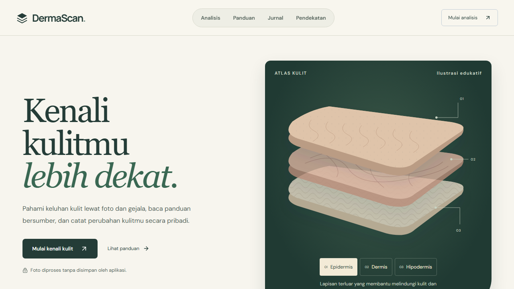

# DermaScan

[](https://github.com/gege010/DermaScan/actions/workflows/ci.yml)

DermaScan adalah aplikasi edukasi kulit berbahasa Indonesia untuk orang dewasa. Pengguna dapat mencatat gejala, menambahkan foto, membaca panduan dermatologi beserta sumbernya, dan menyiapkan riwayat perubahan kulit untuk konsultasi.



## Fitur dan privasi

- **Analisis keluhan.** Gejala menjadi titik awal dan foto bersifat opsional. Aplikasi mengutamakan arahan untuk gejala serius dan menjelaskan saat foto belum bisa dinilai. Mode edukasi berjalan tanpa model, TensorFlow, atau kunci API.
- **Atlas dan panduan.** Jelajahi tiga lapisan kulit, cari artikel berdasarkan topik atau kategori, lalu buka sumber aslinya.
- **Jurnal pribadi.** Buat, sunting, ekspor, dan hapus catatan. Secara default catatan hanya bertahan selama sesi. Jika penyimpanan lokal diaktifkan, orang yang memakai profil browser yang sama dapat membacanya.
- **Pemrosesan foto.** API memproses unggahan sementara tanpa menyimpannya sebagai arsip atau mengirimkannya ke penyedia AI eksternal.

DermaScan ditujukan untuk edukasi dan riset. Model opsional belum divalidasi untuk diagnosis klinis. Rincian data, evaluasi, dan keterbatasan tersedia di [kartu model](docs/MODEL_CARD.md).

## Mulai dengan Docker

Siapkan Git dan Docker dengan plugin Compose, lalu jalankan dari terminal.

```sh
git clone https://github.com/gege010/DermaScan.git
cd DermaScan
docker compose up --build --wait
```

Buka [aplikasi lokal](http://127.0.0.1:8080). Instalasi awal memakai mode edukasi tanpa konfigurasi tambahan. Jika analisis gagal dimuat, periksa [kesiapan API](http://127.0.0.1:8080/ready) dan jalankan `docker compose logs api web`. Untuk menghentikan aplikasi, jalankan `docker compose down`.

## Pengembangan lokal

Gunakan Python 3.11 dan Node.js 22.12+ atau 24 LTS. Dari direktori utama repositori, buat lingkungan Python dan jalankan API di terminal pertama.

```sh
python -m venv .venv
```

Aktifkan dengan `.\.venv\Scripts\Activate.ps1` di PowerShell atau `source .venv/bin/activate` di Bash. Lalu jalankan:

```sh
python -m pip install -r requirements-dev.txt
python -m uvicorn deployment.api.main:app --host 127.0.0.1 --port 8000 --no-access-log
```

Di terminal kedua, mulai antarmuka React dari direktori utama.

```sh
cd web
npm ci
npm run dev
```

Buka [antarmuka pengembangan](http://127.0.0.1:5173). Vite meneruskan permintaan API ke port 8000. Opsi konfigurasi tersedia di [.env.example](.env.example).

### Pengujian

Jalankan tes backend dari direktori utama dengan lingkungan Python aktif.

```sh
python -m pytest -q
```

Jalankan pemeriksaan frontend dari direktori `web/`.

```sh
npm run format:check
npm run build
npx playwright install chromium
npm test
```

Playwright menjalankan server uji sendiri pada port 5180. Gunakan `DERMASCAN_TEST_PORT` jika port tersebut sedang dipakai. Cakupan tes dan batas verifikasi dijelaskan di [catatan pengujian](docs/VERIFICATION.md).

## Dokumentasi

| Kebutuhan | Rujukan |
| --- | --- |
| Menyiapkan deployment dan proksi | [Panduan deployment](docs/DEPLOYMENT.md) |
| Memahami model dan eksperimen | [Kartu model](docs/MODEL_CARD.md) · [Skrip pelatihan](scripts/train_compact.py) |
| Memahami tujuan produk dan alur pengguna | [Spesifikasi produk](PRODUCT.md) · [Kontrak UX](UX-CONTRACT.md) |
| Mengembangkan antarmuka yang konsisten | [Sistem desain](DESIGN.md) |

## Bantuan dan kontribusi

Repositori ini dikelola oleh [@gege010](https://github.com/gege010). Untuk melaporkan masalah, sertakan langkah reproduksi, hasil yang diharapkan, serta versi browser atau lingkungan yang digunakan. Gunakan data sintetis untuk contoh dan tangkapan layar agar informasi kesehatan pribadi tetap terlindungi. [Buka GitHub Issues](https://github.com/gege010/DermaScan/issues).
